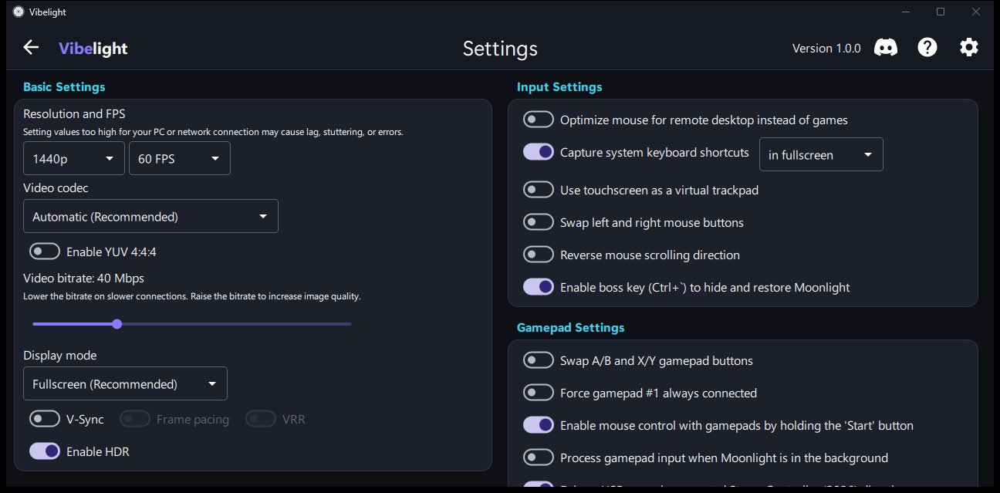

# Vibelight

**Vibelight** is a Windows game-streaming client for [Sunshine](https://github.com/LizardByte/Sunshine)-based hosts. It is a fork of [Nonary's Moonlight client](https://github.com/Nonary/moonlight-qt) (itself a fork of [Moonlight PC](https://github.com/moonlight-stream/moonlight-qt)) with a **boss key**, a **refreshed 2026 look**, and a **single-file download**.



## Download

Get the latest `Vibelight-x.y.z.exe` from the **[Releases page](https://github.com/tleung927/vibelight/releases/latest)**.

* Windows 10/11, x64 only.
* It is one file. Double-click it. On the first run it unpacks itself once into `%LOCALAPPDATA%\Vibelight\<version>` and starts; later runs start immediately from there.
* No administrator rights are needed.
* The exe is **not code-signed**. Windows SmartScreen may say "unknown publisher": choose **More info**, then **Run anyway**. Windows Firewall will also ask once for network access: choose **Allow**, or streaming will not work.
* To uninstall, delete the exe and the `%LOCALAPPDATA%\Vibelight` folder.
* Vibelight uses the same settings store as Moonlight, so settings and paired PCs carry over from an existing Moonlight install, and the other way round.

## What's different

### Boss key (Ctrl+`)

Press **Ctrl+`** (the key left of `1` on a US keyboard) to instantly hide every Vibelight window, including its taskbar button and Alt+Tab entry. Press it again to bring everything back.

* Works in the launcher and during a stream.
* While hidden, the stream stays connected but its audio is muted, and the mouse and keyboard are released so you can work normally.
* Exclusive full-screen streams drop out of full-screen before hiding, so your desktop is not disturbed.
* **Off by default.** Turn it on in **Settings, Input Settings, Enable boss key**. While enabled, Ctrl+` is captured system-wide, so it will not reach other apps or your host PC.

### 2026 look

A dark theme with a violet accent, rounded cards, status chips on PCs (Online, Offline, Not paired), a "Running" badge on live games, grouped settings cards with toggle switches, and a title bar that follows the theme on Windows 11. Layout and keyboard/gamepad navigation are unchanged.

### Inherited from Nonary's client

Vibelight builds on the features of [Nonary/moonlight-qt](https://github.com/Nonary/moonlight-qt), such as variable-refresh-rate (VRR) pacing, the PyroWave codec option, DualSense speaker audio, Steam Controller support, and putting a paired host to sleep from the client. These are designed for hosts that support them, for example [Vibepollo](https://github.com/Nonary/Vibepollo). See that project for details. Everything from Moonlight itself (H.264/HEVC/AV1, HDR, surround sound, gamepad support, and so on) is still here.

## Building from source

Releases are built on Windows x64. macOS (Apple silicon) also builds, see below. Linux code from upstream is untouched and has not been built for Vibelight.

### macOS

Needs the Xcode Command Line Tools and Homebrew. From the repository root:

```sh
brew install qt create-dmg
git submodule update --init --recursive
PATH=/opt/homebrew/opt/qt/bin:$PATH ./scripts/generate-dmg.sh Release
```

This produces `build/installer-Release/Vibelight-x.y.z.dmg` containing `Vibelight.app`. The app is ad-hoc signed, not notarized: the first time, right-click it and choose **Open**. It reads the same settings and paired PCs as Moonlight.

**Pause AWDL while streaming** (Settings, Input Settings, macOS only). AWDL is the Wi-Fi link behind AirDrop, Handoff and iPhone Mirroring. While it is active the Mac's radio leaves the router's channel now and then, which shows up as 20-100 ms latency spikes in the stream. With this on, Vibelight takes `awdl0` down when a stream starts and brings it back when the stream ends (or on the next launch, if Vibelight crashed). Turning it on asks for your admin password once, to add `/etc/sudoers.d/vibelight-awdl`, which allows only `ifconfig awdl0 down` and `ifconfig awdl0 up` without a password. Turning it off removes that file.

### Windows

You need:

* [Visual Studio 2022](https://visualstudio.microsoft.com/downloads/) with the **MSVC v143** toolset and a **Windows 10/11 SDK**
* Qt 6.11.1 for **MSVC 2022 64-bit**

Then, from a Visual Studio x64 developer prompt in the repository root:

```bat
git submodule update --init --recursive
powershell -ExecutionPolicy Bypass -File setup-deps.ps1
set PATH=C:\Qt\6.11.1\msvc2022_64\bin;%PATH%
qmake moonlight-qt.pro -spec win32-msvc "CONFIG+=release"
nmake release
```

The program is built at `app\release\Moonlight.exe`. To run it elsewhere, copy it next to `AntiHooking\release\AntiHooking.dll` and the DLLs in `libs\windows\lib\x64`, then run `windeployqt --release --qmldir app\gui` on it.

## Credits and license

Vibelight is free software under the **GNU General Public License v3.0** (see [LICENSE](LICENSE)); the source for every release is in this repository.

It stands on the work of the [Moonlight](https://moonlight-stream.org) developers and of [Nonary](https://github.com/Nonary). Vibelight is an independent fork and is **not affiliated with or endorsed by** the Moonlight project, Nonary, LizardByte or NVIDIA. Releases bundle third-party libraries (Qt, SDL, FFmpeg, libplacebo, OpenSSL, Opus, and others) under their own licenses.
